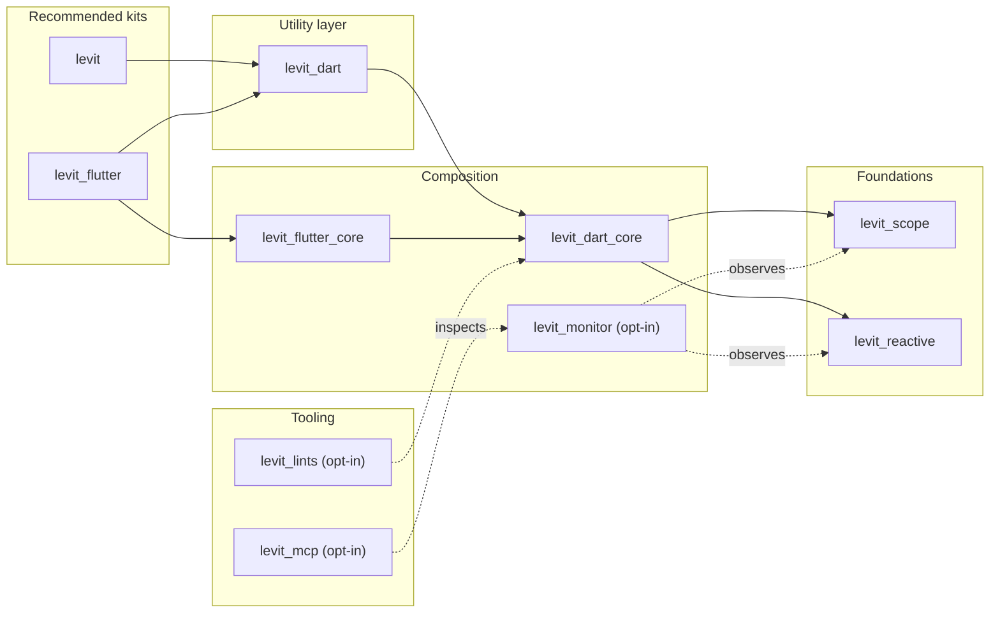

# Levit

Deterministic ownership and fine-grained reactivity for Dart and Flutter.

[](https://opensource.org/licenses/MIT)
[](https://www.codefactor.io/repository/github/atoumbre/levit)
[](https://codecov.io/github/atoumbre/levit)

Levit is for teams whose hardest state problems are really ownership and lifecycle problems.
It gives Dart and Flutter applications one runtime model for dependency scope, cleanup, and reactive updates, so it is easier to answer:

- What owns this dependency or controller?
- When does it get disposed?
- What caused this recomputation or rebuild?
- Can the same architecture work in Flutter and pure Dart code?

If you want the full architectural rationale, tradeoffs, and fit guidance, start with [`docs/WHY_LEVIT.md`](./docs/WHY_LEVIT.md).

## Why Teams Choose Levit

- Scoped ownership: feature, route, and subtree boundaries can own their own registrations and controllers.
- Deterministic teardown: child scopes dispose what they created when the boundary goes away.
- Fine-grained updates: reactive reads drive focused recomputation and rebuilds instead of broad invalidation.
- One model across Dart and Flutter: shared domain logic, services, CLI tools, and Flutter UI can follow the same rules.
- Optional observability: add runtime telemetry only when you need diagnostics or event export.

Levit is most valuable once lifecycle bugs, unclear dependency boundaries, or overly broad rebuild behavior are already costing real time.
If your app is still small enough that ownership is obvious everywhere, it may be more framework than you need.

## Installation

### Flutter applications

```bash
flutter pub add levit_flutter:^0.1.0-beta.1
```

### Pure Dart applications (CLI, server, shared domain)

```bash
dart pub add levit:^0.1.0-beta.1
```

## Start with scopes → owners → state → widgets

Requires Dart 3.12+ and Flutter 3.44+ for Flutter apps. Choose the lifetime first,
register its owner, keep state on that owner, then observe it from focused widgets.
Follow the [onboarding guide](docs/ONBOARDING.md) and use
[advanced helpers](docs/ADVANCED.md) when needed.

## Quick Start

### Pure Dart

```dart
import 'package:levit/levit.dart';

class CounterController extends LevitController {
  final count = 0.lx;
  @override
  void onInit() {
    super.onInit();
    own(count);
  }
  void increment() => count.value++;
}

Future<void> main() async {
  final scope = Levit.createScope('app');

  try {
    final controller = scope.put(() => CounterController());
    controller.increment();
    print(controller.count.value);
  } finally {
    await scope.dispose();
  }
}
```

### Flutter

```dart
import 'package:flutter/material.dart';
import 'package:levit_flutter/levit_flutter.dart';

class CounterController extends LevitController {
  final count = 0.lx;
  void increment() => count.value++;
}

class CounterPage extends StatelessWidget {
  const CounterPage({super.key});

  @override
  Widget build(BuildContext context) {
    return LScopedView<CounterController>.put(
      () => CounterController(),
      autoWatch: false,
      builder: (context, controller) => Scaffold(
        body: Center(
          child: LWatch(() => Text('Count: ${controller.count()}')),
        ),
        floatingActionButton: FloatingActionButton(
          onPressed: controller.increment,
          child: const Icon(Icons.add),
        ),
      ),
    );
  }
}

void main() {
  Levit.enableAutoLinking();
  runApp(const MaterialApp(home: CounterPage()));
}
```

## What Makes Levit Different

Most stacks solve state, dependency injection, and widget rebuilds with separate tools.
That can work well for a while, but the seams show up when a codebase grows:

- state survives longer than the feature that created it
- dependencies can be resolved, but ownership is unclear
- rebuilds happen, but the triggering read is hard to trace
- pure Dart code and Flutter UI follow different lifecycle rules

Levit takes a different position: scope ownership, cleanup, and reactive propagation should belong to the same runtime model.

## Evidence

The proposition is not just conceptual. This repo includes:

- Cross-framework benchmarks under a shared harness: [`benchmarks/README.md`](./benchmarks/README.md), [`reports/benchmark_report.md`](./reports/benchmark_report.md)
- Stress tests for reactive, DI, and Flutter lifecycle behavior: [`stress_tests/README.md`](./stress_tests/README.md), [`reports/stress_test_report.md`](./reports/stress_test_report.md)
- Examples that show feature scopes, async patterns, and route ownership in practice: [`examples/`](./examples)

## Which Package Should I Import?

| Goal | Package | Notes |
| :-- | :-- | :-- |
| Flutter application | [`levit_flutter`](./packages/kits/levit_flutter) | Recommended single import for Flutter apps (includes `tasks.dart` and `levit_testing.dart`). |
| Pure Dart application | [`levit`](./packages/kits/levit) | Recommended single import for CLI, server, and shared domain code (includes `tasks.dart` and `levit_testing.dart`). |
| Flutter bindings without the higher-level Flutter kit | [`levit_flutter_core`](./packages/core/levit_flutter_core) | Owns `LScope`, `LWatch`, `LView`, builders, and `ValueListenable` interop; re-exports `levit_dart_core`. |
| Core composition APIs only | [`levit_dart_core`](./packages/core/levit_dart_core) | Owns `Levit`, `LevitController`, `LevitStore`, and resource ownership contracts. |
| Task, query, loop, and timer utilities on Dart core | [`levit_dart`](./packages/kits/levit_dart) | Adds `LevitTaskGroup`, `LevitAsyncMap`, countdowns, loops, and controller mixins without Flutter. |
| Reactive primitives only | [`levit_reactive`](./packages/core/levit_reactive) | Owns `LxVar`, `LxComputed`, `LxWorker`, `LxResource`, and batch propagation. |
| Scoped DI & lifecycle only | [`levit_scope`](./packages/core/levit_scope) | Owns hierarchical `LevitScope`, aliases, factories, and deterministic LIFO disposal. |
| Runtime telemetry and diagnostics | [`levit_monitor`](./packages/core/levit_monitor) | Opt-in; add separately when you need redaction, snapshots, or event export. |
| Lifecycle & reactive analyzer rules *(workspace tool)* | [`levit_lints`](./packages/tools/levit_lints) | Native Dart analyzer plugin; no runtime dependency. |
| Live runtime MCP server *(workspace tool)* | [`levit_mcp`](./packages/tools/levit_mcp) | Read-only stdio MCP server over authenticated loopback WebSockets. |
| Agent authoring skill | [`skills/levit`](./skills/levit/SKILL.md) | Portable Agent Skill with Levit patterns and best practices. |

## Architecture Model



`levit_monitor` is intentionally separate from `levit` and `levit_flutter`; add it only when you need runtime telemetry.

## Testing Ownership & Cleanup

Both kits expose `levit_testing.dart` (`package:levit/levit_testing.dart` and `package:levit_flutter/levit_testing.dart`) with `LevitTestScope` for isolated store overrides, explicit async tracking (`track` / `settle`), and awaited teardown that surfaces cleanup errors:

```dart
final harness = LevitTestScope(
  overrides: [counterStore.overrideWith((ref) => ref.own(10.lx))],
);
addTearDown(harness.close);
```

See [docs/ONBOARDING.md](docs/ONBOARDING.md#5-test-ownership-and-cleanup) for both pure Dart and Flutter widget teardown tests.

## Middleware Lifecycle

Token-based registration is the canonical pattern:

- Use one stable token per concern.
- Re-register with the same token to replace behavior in place.
- Remove by token during feature teardown.

Reference docs:

- DI middleware lifecycle: [`packages/core/levit_scope/README.md`](./packages/core/levit_scope/README.md)
- Reactive middleware lifecycle: [`packages/core/levit_reactive/README.md`](./packages/core/levit_reactive/README.md)
- Unified facade lifecycle: [`packages/core/levit_dart_core/README.md`](./packages/core/levit_dart_core/README.md)

## Documentation Contract

- Inline DartDoc on public APIs is the authoritative API reference.
- Package READMEs document package scope, architecture role, and onboarding.
- This root README documents ecosystem-level architecture and adoption guidance.

The runtime stays independent of storage backends; persistence codecs,
storage adapters, and persistent task caches are intentionally kept outside
runtime dependencies. Native Flutter interoperability and runtime correctness
remain in this repository.

## For AI assistants

Agents and coding tools should start with [`AGENTS.md`](./AGENTS.md), then:

- [`LLM-Short.txt`](./LLM-Short.txt) — default quick reference for Levit patterns
- [`LLM.txt`](./LLM.txt) — full guidance for scopes, stores, async DI, and middleware

## Examples

Example applications live in [`examples/`](./examples):

- [`examples/task_board`](./examples/task_board)
- [`examples/async_catalog`](./examples/async_catalog)
- [`examples/route_scopes`](./examples/route_scopes)
- [`examples/scope_playground`](./examples/scope_playground)
- [`examples/nexus_studio`](./examples/nexus_studio)

## Contributing

```bash
melos bootstrap
melos test
```

See [`CONTRIBUTING.md`](./CONTRIBUTING.md) for workflow details.
